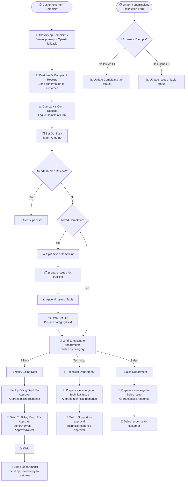

# 🎫 AI-Powered Complaint Management System

An n8n workflow that automates end-to-end customer complaint handling — from intake to AI classification, department routing, AI-drafted responses, supervisor approval, and status tracking.

> **Latest version:** `complaint2.json` — now with full AI response drafting for **all departments** (Billing, Technical, Sales), improved node naming, and removal of the unused Merge node.

---

## 📋 What It Does

When a customer submits a complaint through a web form, this workflow:

1. **Receives the complaint** via an n8n form
2. **Classifies it with AI** (Google Gemini + OpenAI fallback) into: `Billing`, `Sales`, `Technical`, or `Others (HR)`
3. **Handles mixed complaints** — if a customer raised more than one issue, each issue is split and routed separately
4. **Flags unclear complaints** for human review
5. **Logs everything** to Google Sheets (`Complaints` tab + `Issues_Table` tab)
6. **Sends confirmation** to the customer with their unique Form ID
7. **Routes each issue** to the correct department email
8. **Drafts an AI-generated response** (Gemini) for **Billing, Technical, and Sales** issues *(new in v2)*
9. **Sends it to a supervisor for approval** (Approve / Reject via email)
10. **Notifies the customer** once approved
11. Provides a **Resolution Form** for agents to update issue status

---

## 🗺️ Flow Diagram

---

## 🆕 What Changed in v2 (complaint2.json)

| Change | Detail |
|---|---|
| ✅ **AI drafting for Technical issues** | New `Prepare a message for Technical Issue` LLM chain + Gemini model + structured parser |
| ✅ **AI drafting for Sales issues** | New `Prepare a message for Sales Issue` LLM chain + Gemini model + structured parser |
| ✅ **Removed unused Merge node** | Cleaned up — was present but disconnected in v1 |
| ✅ **Nodes renamed for clarity** | e.g. `Basic LLM Chain` → `Classifying Complaints`, `If` → `Needs Human Review?`, `If1` → `Mixed Complaint?`, `Send a message1` → `Customer's Complaint Receipt` |
| ✅ **Sales & Technical routing now fully wired** | Both departments now have downstream AI drafting nodes |
| ✅ **Total nodes: 29 → 34** | +6 added, -1 removed (Merge) |

---

## 🧩 Node-by-Node Breakdown

### PART 1 — Complaint Intake & AI Classification

| Node | Type | What it does |
|---|---|---|
| **Customer's Form Complaint** | Form Trigger | Public web form: Customer Name, Complaint (textarea), Email |
| **Classifying Complaints** | AI Chain | Sends complaint to AI for classification. Gemini primary, OpenAI fallback |
| **Google Gemini Chat Model** | LLM | Primary model (`gemini-3.5-flash`) |
| **OpenAI Chat Model** | LLM | Fallback model (`gpt-5-mini`) |
| **Structured Output Parser** | Output Parser | Returns strict JSON: `customer Name`, `complaint`, `issues[]`, `Email`, `Form id`, `mixed_complaints`, `needs_review` |

**Classification rules:**
- One issue → `mixed_complaints: false`
- Multiple issues → `mixed_complaints: true`
- Unclear → `needs_review: true`
- Categories: `Billing`, `Sales`, `Technical`, `Others (complaint sent to HR)`
- Form ID: auto-generated as `CMP-{execution_id}`

---

### PART 2 — Confirmation & Logging

| Node | Type | What it does |
|---|---|---|
| **Customer's Complaint Receipt** | Gmail | Sends confirmation to customer with their Form ID |
| **Company's Com. Receipt** | Google Sheets | Appends to `Complaints` tab: Name, complaint, issue type(s), email, Form ID |
| **Set Out Data** | Set | Flattens AI output into clean fields for downstream nodes |

---

### PART 3 — Review & Routing Logic

| Node | Type | What it does |
|---|---|---|
| **Needs Human Review?** | IF | Checks `needs_review = true` → alerts supervisor |
| **Mixed Complaint?** | IF | Checks `mixed_complaints = true` |
| **Split mixed Complaint** | SplitOut | Splits `issues[]` into individual items |
| **prepare issues for tracking1** | Set | Assigns each issue a unique ID: `{Form ID}-i1`, `{Form ID}-i2`… |
| **Append row in sheet1** | Google Sheets | Logs each issue to `Issues_Table` with status `Received` |
| **Data Set-Out** | Set | Prepares `issue_text` + `category` for the Switch router |
| **send complaint to departments** | Switch | Routes: `Billing` → 0, `Sales` → 1, `Technical` → 2 |

---

### PART 4 — Department Notifications

| Node | Type | What it does |
|---|---|---|
| **Notify Billing Dept. For Approval** | Gmail | Notifies billing team of a new complaint |
| **Technical Department** | Gmail | Notifies technical team |
| **Sales Department** | Gmail | Notifies sales team |

---

### PART 5 — AI Response Drafting & Approval *(all departments in v2)*

#### Billing
| Node | Type | What it does |
|---|---|---|
| **Notify Billing Dept. For Approval** | AI Chain | Drafts professional billing response using Gemini |
| **Google Gemini Chat Model1** | LLM | Powers billing response drafting |
| **Structured Output Parser1** | Output Parser | Returns `customer_name`, `customer_email`, `email_body`, `form_id`, `complaint` |
| **Send To Billing Dept. For Approval** | Gmail (sendAndWait) | Sends draft to supervisor — waits for Approve/Reject |
| **Wait** | Wait | 30-second pause after approval |
| **Billing Department1** | Gmail | Sends approved email to customer |

#### Technical *(new in v2)*
| Node | Type | What it does |
|---|---|---|
| **Prepare a message for Technical Issue** | AI Chain | Drafts professional technical acknowledgement email |
| **Google Gemini Chat Model2** | LLM | Powers technical response drafting |
| **Structured Output Parser2** | Output Parser | Same schema as billing parser |
| **Mail to Support for approval** | Gmail | Sends for supervisor review |

#### Sales *(new in v2)*
| Node | Type | What it does |
|---|---|---|
| **Prepare a message for Sales Issue** | AI Chain | Drafts professional sales acknowledgement email |
| **Google Gemini Chat Model3** | LLM | Powers sales response drafting |
| **Structured Output Parser3** | Output Parser | Same schema as billing parser |

**All AI response rules (consistent across all departments):**
- Acknowledge and apologise for the inconvenience
- Confirm the complaint will be sorted — do NOT promise a timeline or provide a fix
- Ask for additional details that might help resolve it faster
- Professional, empathetic tone — plain text email body only

---

### PART 6 — Resolution Tracking

| Node | Type | What it does |
|---|---|---|
| **On form submission1** | Form Trigger | Internal agent form: Complaint ID, Issues ID, Comment |
| **If2** | IF | Checks if `Issues ID` is empty |
| **Update row in sheet1** | Google Sheets | No Issues ID → updates `Complaints` tab status |
| **Update row in sheet** | Google Sheets | Has Issues ID → updates `Issues_Table` status |

---

## 📊 Google Sheets Structure

**Spreadsheet:** [Customer's Complaints](https://docs.google.com/spreadsheets/d/1DzJ2kI6Stqomkir5EDxf9yndPwig_E5xz1NJGFIfbk0)

### Tab 1: `Complaints`
| Column | Description |
|---|---|
| Customer Name | Full name from form |
| Complaints | Raw complaint text (as classified by AI) |
| Type of issue | All categories joined with ` \| ` (e.g. `Billing \| Technical`) |
| Customer's Email | Customer email address |
| Form ID | Unique ID e.g. `CMP-abc123` |
| Status | Updated via Resolution Form |

### Tab 2: `Issues_Table`
| Column | Description |
|---|---|
| Name | Customer name |
| Email | Customer email |
| Issues id | Per-issue ID e.g. `CMP-abc123-i1` |
| Customer id | The issue text |
| Status | `Received` on creation; updated via Resolution Form |

---

## 🔧 Required Credentials

| Credential | Used by | Type |
|---|---|---|
| `Google Gemini (PaLM) Api account` | Classification + all 3 response drafters | Google PaLM API key |
| `OpenAI account` | Fallback classifier | OpenAI API key |
| `Google Sheets account` | All sheet operations | Google OAuth2 |
| `Gmail account` | All email sends | Gmail OAuth2 |

---

## 🚀 How to Import & Use

1. Open your n8n instance
2. Go to **Workflows → Import**
3. Upload `complaint2.json` *(latest)* or `complaint1.json` *(original)*
4. Set up the 4 credentials above
5. Update department email addresses in the Gmail nodes to your real team emails
6. Activate the workflow
7. Share the **Complaint Form** URL with customers
8. Share the **Resolution Form** URL with your support agents

---

## 📁 Files

| File | Description |
|---|---|
| `complaint1.json` | v1 — Original workflow (Billing AI response only) |
| `complaint2.json` | v2 — Full AI responses for Billing, Technical & Sales |

---

## ⚠️ Remaining Improvement Suggestions

| Issue | Suggestion |
|---|---|
| Technical & Sales approval flow not fully wired | Add sendAndWait + Wait nodes after Technical and Sales response drafters, mirroring the Billing flow |
| `Billing Department1` sends to supervisor email, not customer | Update `sendTo` to `$('Customer's Form Complaint').item.json.Email` |
| Typo in form title | "Compalint Form" → "Complaint Form" |
| Others/HR category has no downstream handler | Add a Gmail node after Switch default output for HR routing |

---

*Built by [Benback](https://github.com/Benback)*
