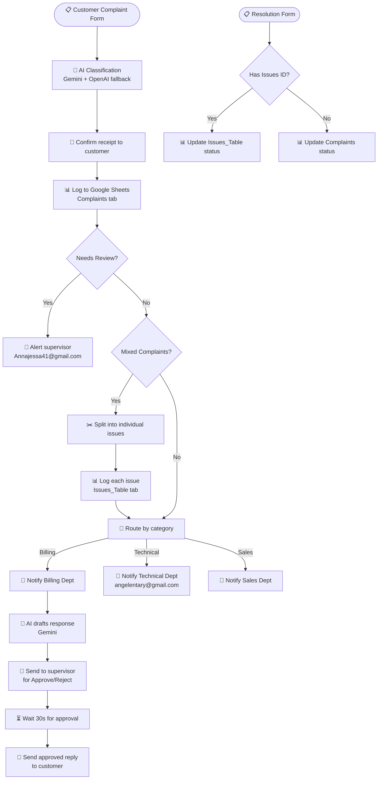

# 🎫 AI-Powered Complaint Management System

An n8n workflow that automates end-to-end customer complaint handling — from intake to department routing, AI-drafted responses, supervisor approval, and status tracking — all without manual triage.

---

## 📋 What It Does

When a customer submits a complaint through a web form, this workflow:

1. **Receives the complaint** via an n8n form
2. **Classifies it with AI** (Google Gemini / OpenAI) into: `Billing`, `Sales`, `Technical`, or `Others (HR)`
3. **Handles mixed complaints** — if a customer raised more than one issue, each issue is split and routed separately
4. **Flags unclear complaints** for human review
5. **Logs everything** to Google Sheets (two tabs: `Complaints` and `Issues_Table`)
6. **Sends confirmation** to the customer with their unique Form ID
7. **Routes each issue** to the correct department email
8. **Drafts an AI-generated response** (Gemini) for Billing issues
9. **Sends it to a supervisor for approval** (Approve / Reject via email)
10. **Notifies the customer** once approved
11. Provides a **Resolution Form** for agents to update issue status

---

## 🗺️ Flow Diagram

---

## 🧩 Node-by-Node Breakdown

### PART 1 — Complaint Intake & Classification

| Node | Type | What it does |
|---|---|---|
| **On form submission** | Form Trigger | Public web form with 3 fields: Customer Name, Complaint (textarea), Email |
| **Basic LLM Chain** | AI Chain | Sends complaint to AI for classification. Uses Gemini as primary, OpenAI GPT as fallback |
| **Google Gemini Chat Model** | LLM | Primary model (`gemini-3.5-flash`) for classification |
| **OpenAI Chat Model** | LLM | Fallback model (`gpt-5-mini`) if Gemini fails |
| **Structured Output Parser** | Output Parser | Forces AI to return strict JSON with: `customer Name`, `complaint`, `issues[]`, `Email`, `Form id`, `mixed_complaints`, `needs_review` |

**AI Classification Rules (from the prompt):**
- One issue → `mixed_complaints: false`
- Multiple issues → `mixed_complaints: true`, each issue returned separately
- Unclear complaint → `needs_review: true`
- Categories: `Billing`, `Sales`, `Technical`, `Others (complaint sent to HR)`
- Form ID auto-generated as `CMP-{execution_id}`

---

### PART 2 — Confirmation & Logging

| Node | Type | What it does |
|---|---|---|
| **Send a message1** | Gmail | Sends confirmation email to customer: *"We received your complaint — your ID is CMP-xxx"* |
| **Append row in sheet** | Google Sheets | Logs to `Complaints` tab: Customer Name, Complaint text, Issue type(s), Email, Form ID |
| **Edit Fields** | Set | Flattens AI output into clean fields for downstream nodes |

---

### PART 3 — Review & Routing Logic

| Node | Type | What it does |
|---|---|---|
| **If** (needs_review check) | IF | Checks if `needs_review = true` |
| **Send a message** | Gmail | If needs review → alerts `Annajessa41@gmail.com` with full complaint details |
| **If1** (mixed_complaints check) | IF | Checks if complaint has multiple issues |
| **Split mixed Complaint** | SplitOut | Splits `issues[]` array into individual items so each can be processed separately |
| **prepare issues for tracking1** | Set | Assigns each issue a unique ID: `{Form ID}-i1`, `{Form ID}-i2`, etc. |
| **Append row in sheet1** | Google Sheets | Logs each issue to `Issues_Table` tab with status `Received` |
| **Edit Fields1** | Set | Prepares issue category and text for the Switch router |
| **send complaint to departments** | Switch | Routes by category: `Billing` → output 0, `Sales` → output 1, `Technical` → output 2, `Others` → default |

---

### PART 4 — Department Notifications

| Node | Type | What it does |
|---|---|---|
| **Billing Department** | Gmail | Notifies `Annajessa41@gmail.com` of a billing complaint |
| **Technical Department** | Gmail | Notifies `angelentary@gmail.com` of a technical complaint |
| *(Sales/Others)* | *(not yet wired)* | Switch outputs 1 & 2 currently have no downstream nodes |

---

### PART 5 — AI Response Drafting & Approval (Billing only)

| Node | Type | What it does |
|---|---|---|
| **Basic LLM Chain1** | AI Chain | Drafts a professional, empathetic billing response email using Gemini |
| **Google Gemini Chat Model1** | LLM | Powers the response drafting |
| **Structured Output Parser1** | Output Parser | Returns: `customer_name`, `customer_email`, `email_body`, `form_id`, `complaint` |
| **Send message and wait for response** | Gmail (sendAndWait) | Sends draft to supervisor (`annajessa41@gmail.com`) with Approve/Reject buttons |
| **Wait** | Wait | Pauses 30 seconds after approval before sending to customer |
| **Billing Department1** | Gmail | Sends the approved email body to customer |

**AI Response Drafting Rules (from the prompt):**
- Acknowledge and apologise for inconvenience
- Confirm understanding of the specific billing issue
- Do NOT provide a solution — just assure the customer it will be sorted
- Ask for any details that might help resolve it faster
- Professional, empathetic tone
- Output: plain text email body only (no subject line, no placeholders)

---

### PART 6 — Resolution Tracking (Separate sub-flow)

| Node | Type | What it does |
|---|---|---|
| **On form submission1** | Form Trigger | Internal form for agents: Complaint ID, Issues ID, Comment/Status update |
| **If2** | IF | Checks if `Issues ID` is empty |
| **Update row in sheet1** | Google Sheets | If Complaint ID only → updates status in `Complaints` tab |
| **Update row in sheet** | Google Sheets | If Issues ID present → updates status in `Issues_Table` tab |

---

## 📊 Google Sheets Structure

**Spreadsheet:** [Customer's Complaints](https://docs.google.com/spreadsheets/d/1DzJ2kI6Stqomkir5EDxf9yndPwig_E5xz1NJGFIfbk0)

### Tab 1: `Complaints`
| Column | Description |
|---|---|
| Customer Name | Full name from form |
| Complaints | Raw complaint text |
| Type of issue | All categories joined with ` \| ` (e.g. `Billing \| Technical`) |
| Customer's Email | Email address |
| Form ID | Unique ID e.g. `CMP-abc123` |
| Status | Updated via Resolution Form |

### Tab 2: `Issues_Table`
| Column | Description |
|---|---|
| Name | Customer name |
| Email | Customer email |
| Issues id | Per-issue ID e.g. `CMP-abc123-i1` |
| Customer id | The issue text (note: column label is misleading) |
| Status | `Received` on creation; updated via Resolution Form |

---

## 🔧 Required Credentials

Configure these in your n8n instance before importing:

| Credential | Used by | Type |
|---|---|---|
| `Google Gemini (PaLM) Api account` | Classification + Response drafting | Google PaLM API key |
| `OpenAI account` | Fallback classifier | OpenAI API key |
| `Google Sheets account` | All sheet operations | Google OAuth2 |
| `Gmail account` | All email sends | Gmail OAuth2 |

---

## 🚀 How to Import & Use

1. Open your n8n instance
2. Go to **Workflows → Import**
3. Upload `complaint1.json`
4. Set up the 4 credentials above
5. Update department email addresses in the Gmail nodes to match your real team
6. Activate the workflow
7. Share the **Complaint Form** URL with customers
8. Share the **Resolution Form** URL with your support agents

---

## ⚠️ Known Gaps & Improvement Suggestions

| Issue | Suggestion |
|---|---|
| Sales & Others routing not wired | Add Gmail nodes for Sales and HR departments after Switch outputs 1 & 2 |
| AI response drafting only exists for Billing | Duplicate the LLM Chain → Approve → Send pattern for Technical and Sales |
| `Merge` node is disconnected | Either wire it or remove it — currently has no inputs or outputs |
| `Billing Department1` sends to supervisor email, not customer | Update `sendTo` to use `$('On form submission').item.json.Email` |
| Column label "Customer id" in Issues_Table stores issue text | Rename to `Issue Text` for clarity |
| Typo in form title | "Compalint Form" → "Complaint Form" |

---

## 🛠️ Tech Stack

- **Platform:** [n8n](https://n8n.io) (self-hosted or cloud)
- **AI Models:** Google Gemini (`gemini-3.5-flash`), OpenAI (`gpt-5-mini`)
- **Storage:** Google Sheets
- **Email:** Gmail (via OAuth2)
- **Trigger:** n8n built-in Form

---

*Built by [Benback](https://github.com/Benback)*
